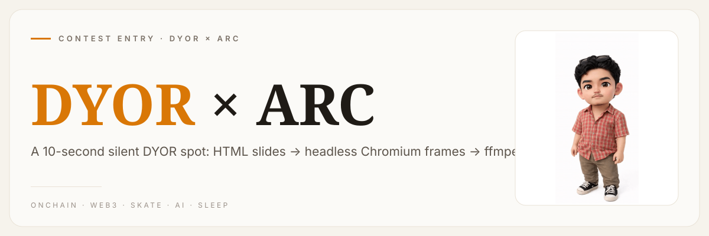
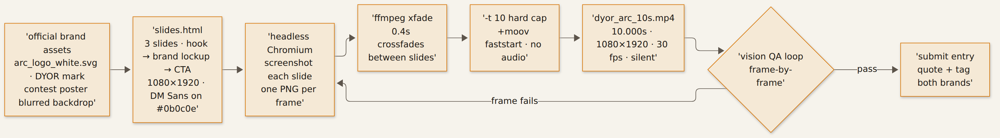

<!-- urelkdubdqwr · website: https://studiopinggirkasur.xyz/ -->



**A 10-second silent DYOR spot: three HTML slides, headless Chromium for frames, ffmpeg xfade for the cut.**

## What it is

Contest entry for the **@DYORSWAPDEX × @arc** video contest — 10 seconds, silent, both brands on screen. Deadline was ~26 hours out, so instead of a motion-graphics suite: slides written as plain HTML/CSS, headless Chromium screenshots every frame, ffmpeg crossfades them into the cut. The artifact ships right here: `dyor_arc_10s.mp4` — 1080×1920, 30 fps, exactly **10.000 s** (ffprobe, not a feeling), zero audio streams. Silent for real.

## How it works



- `slides.html` holds three 1080×1920 slides — text hook ("DYOR IN ARC"), the DYOR × ARC brand lockup, and the CTA end card.
- Slide 2 sits over the contest poster, blurred into a backdrop; the ARC wordmark (`arc_logo_white.svg`, official, from arc.io) and the DYOR mark from their X profile carry the lockup.
- Headless Chromium screenshots each slide — one PNG per frame, no screen recorders involved.
- ffmpeg `xfade` glues the frames with 0.4 s crossfades, capped by `-t 10` with faststart and no audio track.
- A frame-by-frame vision QA loop checked every slide; the brand lockup took three rounds before it passed.
- The winning cut is committed as `dyor_arc_10s.mp4`.

## Quickstart

```bash
git clone https://github.com/urelkdubdqwr/dyor-arc-contest.git
cd dyor-arc-contest

# verify the entry: 1080x1920, 30 fps, 10.000 s, no audio stream
ffprobe dyor_arc_10s.mp4

# open the slide source in a browser
xdg-open slides.html   # or just double-click it
```

Needs: any browser for the slides, `ffprobe`/`ffmpeg` to inspect or re-cut.

## Contest checklist

| Requirement | Where it lands |
|---|---|
| text "DYOR IN ARC" | slide 1, 150px |
| text "Do Your Own Research" | slide 1 + end card |
| DYOR brand element | official X profile mark, slide 2 |
| ARC brand element | official arc.io logo, slide 2 (white wordmark, glow) |
| quote + tag both brands | entry post complies |

## What's inside

| Path | What it is |
|---|---|
| `dyor_arc_10s.mp4` | Final entry. 1080×1920, 30 fps, 10.000 s, no audio. |
| `slides.html` | Slide source: hook → DYOR × ARC lockup → CTA, pure HTML/CSS. |
| `arc_logo_white.svg` | Official ARC wordmark used on slide 2. |
| `assets/header.svg` | Repo banner. |
| `assets/diagram.mmd` + `assets/ecosystem.png` | Pipeline diagram, source + render. |

## License

MIT — see [LICENSE](LICENSE).

---

*gak menang? lo baru aja nonton 10 detik terbaik kontes itu.* 🦅

*Worked from the edge of the bed. → [studiopinggirkasur.xyz](https://studiopinggirkasur.xyz/)*
